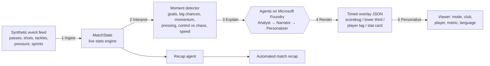

# MatchLens: explainable, personalized match intelligence

**Inside the Game: Developer Hackathon 2026 (Microsoft)** · Built by Kornelia Buszka (West Virginia University)

Football stories don't start and end with the scoreline. MatchLens turns a live feed of **synthetic football
events** into **explainable match intelligence**: live stats, key moments with the evidence for *why* they
matter, broadcast-ready on-screen graphics, and an automated recap, personalized so a data-hungry analyst,
a casual fan, a young fan and a fan following one player get genuinely different experiences, in their language.

## One pipeline, five stages



| Stage | What happens | Code |
|---|---|---|
| **1. Ingest** | A seeded simulator generates a realistic 90-minute match (~2,300 events: passes with ball speed, shots with xG and shot speed, tackles, interceptions, pressure, sprints with speed/distance, fouls, cards). Events are replayed in real time. | `matchlens/synth.py` |
| **2. Interpret** | A live state engine computes possession, pass accuracy, a 0–10 **pass difficulty rating**, xG, shot speed, final-third entries, pressures, player sprint speed/distance, and rolling 5-minute **momentum** and **control-vs-chaos** indices. | `matchlens/stats.py` |
| **3. Explain** | A moment detector flags goals, big chances, momentum swings, pressing spells, chaos/control phases, elite passes, rockets and speed alerts. Each moment carries **structured evidence** (the numbers behind it). AI agents turn that evidence into *why it matters*, and they are told never to invent facts. | `matchlens/moments.py`, `matchlens/agents.py` |
| **4. Render** | Every narrated moment becomes a **timed, machine-readable overlay** (slot, duration, priority, colour, title, body, evidence) that a rendering partner can drop onto a live feed. | `matchlens/render.py`, `GET /api/overlays` |
| **5. Personalize** | Personas (Casual · Analyst · Player focus · Young fan) × favourite club × followed player × favourite metric × 10 languages decide what is shown and how it is written. | `matchlens/personas.py` |

## Multi-agent design (Microsoft Agent Framework + Microsoft Foundry)

| Agent | Job | Tools |
|---|---|---|
| **Analyst** | Checks the evidence and decides why the moment matters | `get_match_snapshot`, `get_player_stats` (live shared state) |
| **Narrator** | Writes broadcast graphics (≤8-word title, ≤25-word line) | — |
| **Personalizer** | Rewrites for the viewer: tone, depth, "your team" framing, language | — |
| **Recap** | Writes the full-time studio/streaming recap | `get_match_snapshot` |

* **One analysis, many fans:** the Analyst and Narrator run once per moment; the Personalizer then runs in parallel
  for every viewer. **Side-by-side mode** shows the same moment told to two viewers at once (e.g. Analyst in English
  vs Young fan in Spanish).
* **Visible orchestration:** every overlay carries an **agent trace** (which agent ran, how long it took, ok / skipped /
  fallback, the Analyst's reasoning and confidence), shown live in the UI.
* **Shared state:** all agents read the same live `MatchState`.
* **Grounded:** agents only receive detected evidence + tool data; prompts forbid invented facts.
* **Fault tolerant:** each step has a timeout and an independent fallback to deterministic templates, plus a
  circuit breaker. The live overlay never goes missing; every overlay records its `source` (`agent` / `template`).
* **Runs offline:** with no Azure config, the full app still works in template mode (English), so anyone can test it.

## Run it

```bash
pip install -r requirements.txt
python -m uvicorn matchlens.server:app --reload
# open http://127.0.0.1:8000  → pick a mode, club, player, language → ▶ Start match
```

Turn on the AI agents (Microsoft Foundry): copy `.env.example` to `.env` and set either the Foundry project
(`FOUNDRY_PROJECT_ENDPOINT`, `FOUNDRY_MODEL`, auth via `az login`) or the Azure OpenAI endpoint of your Foundry resource
(`AZURE_OPENAI_ENDPOINT`, `AZURE_OPENAI_API_KEY`, `AZURE_OPENAI_DEPLOYMENT`).

**Live demo:** https://matchlens-wvu-fmhsdqcwabdbdrdr.eastus2-01.azurewebsites.net/ (Azure App Service + Microsoft Foundry,
gpt-4.1-mini). Try: Mode = Analyst, Compare with = Young fan + Spanish, ▶ Start match.

Tests: `python -m pytest -q` (also run on every push by GitHub Actions; the Azure deploy only happens if they pass).
The tests cover the agent handoffs and the fallback path with fake agents, so they run without Azure.

### API

| Endpoint | Purpose |
|---|---|
| `GET /api/stream?seed=7&speed=60&mode=analyst&club=HOME&lang=es` | Live replay (Server-Sent Events): ticks + overlays |
| `GET /api/overlays?seed=7&mode=player&player=RIV09` | Full timed overlay timeline for one persona (JSON) |
| `GET /api/recap?seed=7&mode=casual&lang=pl` | Automated match recap (Markdown) |
| `GET /api/events?seed=7` | Raw synthetic event feed |

### Deploy (Azure Container Apps)

```bash
az containerapp up --name matchlens --resource-group <rg> --location eastus --source . --ingress external --target-port 8000
```
Give the app a managed identity with access to the Foundry project; `DefaultAzureCredential` picks it up.

## Data

All data is **synthetic** and generated by `synth.py`: fictional clubs (Riverside Rovers, Northgate Athletic),
fictional players, seeded and reproducible. No real match footage, data or club/league trademarks are used.
Realism checks (tests): ~500 passes per team, 75–90% pass accuracy, ~15 m average pass, 0–6 goals.

## Roadmap
- Auto-eventing from video (pose/ball tracking model → the same event schema)
- Azure Event Hubs ingestion for real feeds; Fabric Real-Time Intelligence for the stats store
- Text-to-speech commentary per language (Azure AI Speech)
